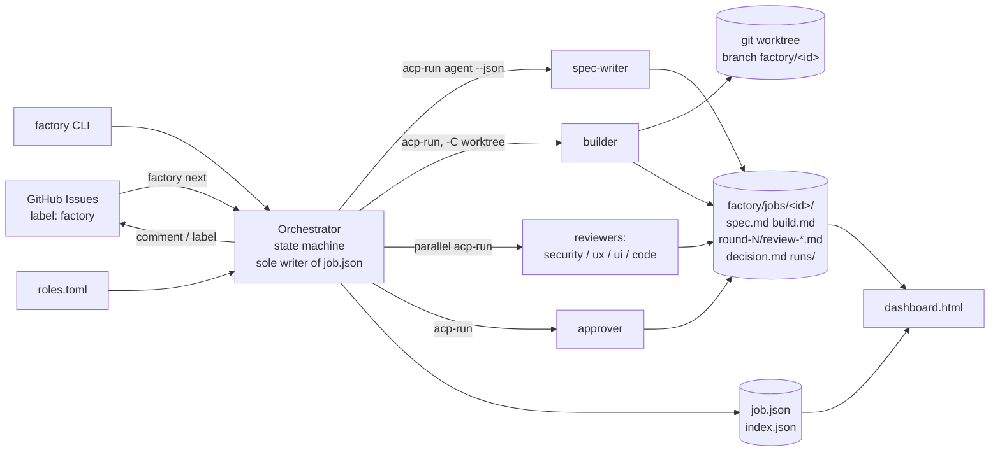
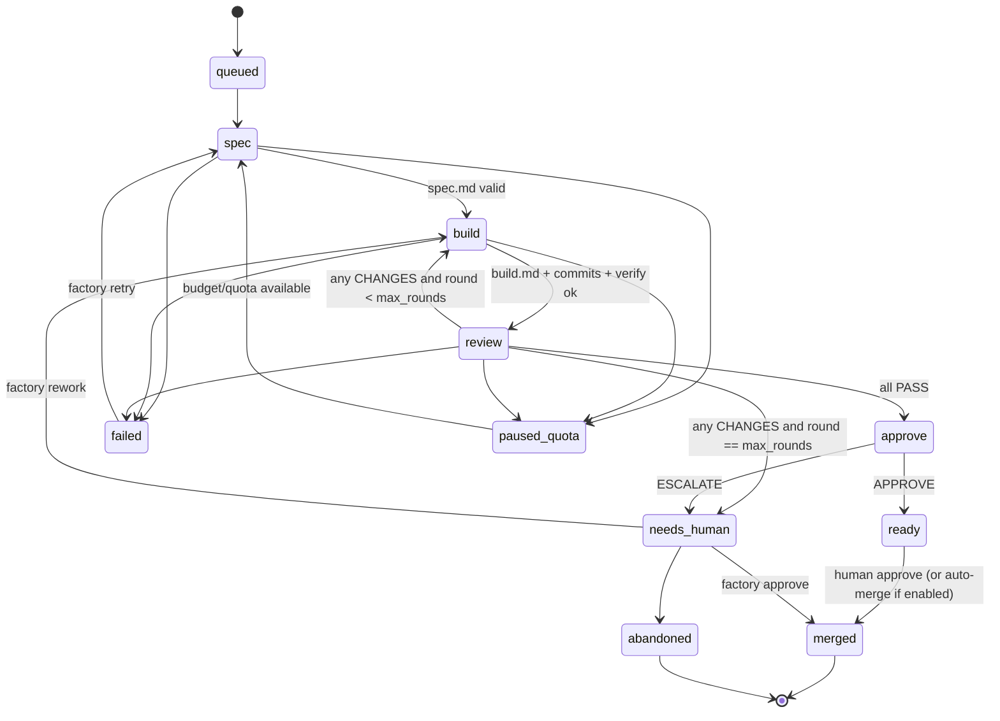
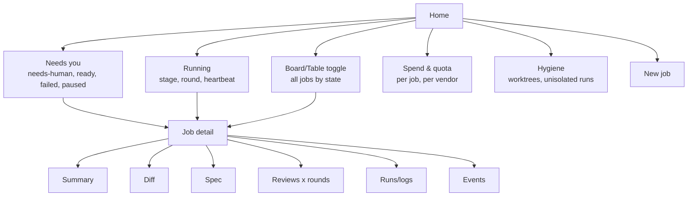

# Software Factory with a Dashboard — Design Doc

Status: DRAFT v2 (revised after AI review, section 12 overrides earlier sections where they conflict) for Daniel's review (branch `design/software-factory`, not merged)
Date: 2026-10-19
Author: Grok Bot, for Daniel Clark

---

## 1. Summary

1. Build an agent-agnostic "software factory": a feature request goes in, a spec, a
   branch with commits, a set of independent reviews, and an approve/escalate
   decision come out.

2. Every role (spec-writer, builder, reviewers, approver) is run through
   `tools/acp-run`, so each role can be any ACP agent (`agy`, `claude`, `cursor`,
   `cline`, ...) with a deliberately chosen model / effort / context.

3. A small, deterministic orchestrator (a program, not an LLM session) drives the
   loop and is the sole writer of state. A dashboard reads the job folders.

---

## 2. Background and prior art

1. **zazencodes factory** (skeleton we borrow; read 2026-10-19 from
   `zazencodes-season-3/src/software-factory-claude-code`):

   1. Flow: `spec-writer` -> `builder` (git worktree, branch `factory/<job-id>`)
      -> 4 parallel reviewers (security, UX, UI, code; each file starts
      `VERDICT: PASS|CHANGES`) -> "WAIT FOR ALL" -> rework (builder resumed,
      `MAX_RESUMES = 2`, so at most 3 review rounds) -> `approver`
      (`APPROVE|ESCALATE`) -> merge or `needs-human`.

   2. State: the orchestrator is the only writer of each job's `job.json`
      (`id, feature, branch, worktree, stage, round, reviews{...}`).
      Note: `BUILD_PROMPT.md` describes a single `factory/board.json`, while the
      shipped `SKILL.md` and example jobs use one `job.json` per job folder. We
      follow the per-job form.

   3. Agents share context only via markdown files (`spec.md`, `build.md`,
      `round-N/review-*.md`, `decision.md`); each writes only its own file.

   4. Dashboard: one self-contained `factory/dashboard.html`, served with
      `python3 -m http.server`, polls job JSON with `fetch(..., {cache:'no-store'})`.

   5. Limitation: Claude Code only (skill + subagents + `SendMessage`); the
      orchestrator is itself an LLM session.

2. **Spec stage candidates:** `github/spec-kit`, `Fission-AI/OpenSpec`.

3. **Backlog:** GitHub Issues as the queue (idea from `ccpm`).

4. **Dashboard inspiration (design ideas only, no code copied — both AGPL):**
   Aperant kanban; `claude-squad` TUI.

5. **Constraint:** open-source components only.

---

## 3. Goals and non-goals

1. Goals

   1. Any role runs on any ACP agent/model/effort, configured per role in one
      file, and the choice is recorded in the job for later comparison.

   2. Deterministic orchestration: state transitions are code, not prompts.

   3. Crash-safe, resumable jobs: kill the orchestrator at any point, restart,
      and it continues from `job.json`.

   4. Parallel jobs, each isolated in its own git worktree and branch.

   5. Hard cost / quota / time guards per role, per job, per day.

   6. A dashboard that a human can understand in a minute: MVP static HTML,
      later live.

   7. Human stays the merge authority by default (APPROVE means "ready", not
      "merged", until Daniel opts in to auto-merge).

2. Non-goals (v1)

   1. No hosted service, no multi-user auth, no database.

   2. No writing our own agent; we only drive agents via ACP.

   3. No auto-deploy.

   4. No copying AGPL code (Aperant, claude-squad).

   5. No cross-repo jobs; one factory instance per target repo.

---

## 4. Architecture

1. Components

   1. `factory` CLI (Python, same style as `acp-run`): `run`, `next`,
      `approve`, `rework`, `status`, `serve`.

   2. Orchestrator loop inside `factory run`: a state machine that shells out
      to `acp-run <agent> --json --log ...` per role invocation.

   3. Role config: `factory/roles.toml` (schema in section 6).

   4. Job folder: `factory/jobs/<job-id>/` with `job.json` + markdown artifacts
      + `runs/` (acp-run JSONL logs and `--json` summaries).

   5. Backlog adapter: GitHub Issues with a label (e.g. `factory`) via `gh`.

   6. Dashboard: static `dashboard.html` reading `factory/jobs/index.json`
      (regenerated by the orchestrator) and each `job.json`.

2. Diagram



3. Key design decisions

   1. Orchestrator is code. LLMs only produce artifacts; the orchestrator parses
      the first line (`VERDICT:` / `APPROVE|ESCALATE`) and nothing else.

   2. Reviewers run read-only where the agent supports it (`--perm read-only`
      works for claude, codex, opencode, zcode per `acp-run --help`); otherwise
      they run in a throwaway copy of the worktree and the orchestrator rejects
      any diff they leave.

   3. Builder resume uses `acp-run --resume <session-id>` when the agent
      supports `loadSession`; otherwise a fresh session gets `spec.md`,
      `build.md`, and the latest round folder.

   4. Builder acceptance check uses `acp-run --verify "<repo test cmd>"`.

---

## 5. Job state machine

1. States

   1. `queued` -> `spec` -> `build` -> `review(N)` -> `approve` ->
      `ready` | `needs-human` -> `merged` | `abandoned`.

   2. Side states: `failed` (agent error / timeout after retries),
      `paused-quota` (budget or vendor quota hit), `cancelled`.

2. Transitions



3. Rules

   1. WAIT FOR ALL: a round closes only when every enabled reviewer wrote a
      parseable verdict file, or the reviewer failed (failure counts as
      CHANGES-with-reason "reviewer failed", never as PASS).

   2. `max_rounds` default 3 (= initial + 2 reworks), as in zazencodes.

   3. Each transition is written atomically (`job.json.tmp` + `rename`) and
      appended to `events.jsonl` in the job folder.

   4. Resume on restart: for a state whose artifact already exists and parses,
      advance; otherwise rerun that step.

4. `job.json` (v1)

   1. `id, feature, issue, branch, worktree, base_sha, head_sha`
   2. `state, round, max_rounds`
   3. `reviews: {role: PASS|CHANGES|pending|failed}`
   4. `runs: [{role, agent, model, effort, session_id, seconds, tokens, cost,
      exit, log}]` (copied from acp-run `--json` output, never estimated)
   5. `budget: {spent, limit}`, `updated_at`

---

## 6. Role config schema (`factory/roles.toml`)

```toml
[defaults]
timeout = 1800            # seconds per acp-run call
prompt_retries = 1
max_rounds = 3

[roles.spec-writer]
agent = "claude"
model = "opus"
effort = "high"
spec_tool = "openspec"    # or "spec-kit" or "plain"
why = "spec quality drives everything downstream"

[roles.builder]
agent = "cursor"
model = "..."             # chosen deliberately
set = { context = "256k" }
verify = "make test"
why = "..."

[roles.reviewer-security]
agent = "claude"
model = "opus"
perm = "read-only"

[roles.reviewer-ux]
agent = "agy"
fallback = ["cline"]      # used only on quota/handshake failure

[roles.reviewer-ui]
enabled = false           # turn off for non-UI repos

[roles.reviewer-code]
agent = "cline"

[roles.approver]
agent = "claude"
model = "opus"
```

1. Fields: `agent` (required), `model`, `effort`, `context`, `set{}`, `perm`,
   `timeout`, `verify`, `fallback[]`, `enabled`, `why` (required free text so
   choices are deliberate), `prompt` (path to role prompt markdown).

2. Role prompts live in `factory/roles/<role>.md`, agent-neutral (ported from
   the zazencodes `.claude/agents/*.md`, with the Claude-specific frontmatter
   moved into `roles.toml`).

3. The orchestrator validates every role with `acp-run <agent> --info --model M`
   at startup and records the model the agent actually reports.

---

## 7. Dashboard UX (particular focus)

The dashboard is the product surface Daniel touches most. It must answer
"does anything need me, and is anything burning money or unisolated?" in one
glance, on a laptop or on a phone.

### 7.1 Survey of prior dashboards (patterns to keep / avoid)

Sources read 2026-10-19 (READMEs, product pages, zazencodes source). Items marked
"(screenshot only)" were not inspected beyond the published image/text.

1. zazencodes `factory/dashboard.html`

   1. Keep: one self-contained HTML file; cards per job moving across loop
      stages; per-round row of reviewer chips filling in; a right-hand drawer
      rendering the job's markdown; needs-human visually distinct; polling with
      `cache: 'no-store'`; explicit empty state.

   2. Avoid: read-only (every action needs a Claude session); no cost, no
      agent/model per role, no stuck detection, no worktree status.

2. Aperant (formerly Auto Claude; AGPL — design ideas only)

   1. Keep: kanban "from planning through completion" with real-time agent
      progress; a separate review-and-merge step per spec.

   2. Avoid: desktop app (Electron-style) is heavy for a phone-first owner;
      tied to Claude. (screenshot only for layout details)

3. claude-squad (AGPL — design ideas only)

   1. Keep: list of sessions + a preview pane with `tab` to toggle preview /
      diff; single-key actions (`n` new, `N` new with prompt, `↵/o` attach,
      `s` commit+push, `c` checkout/pause, `r` resume, `D` kill, `q` quit,
      `shift-↓/↑` scroll diff); review changes before applying.

   2. Avoid: terminal-only, no remote/phone view; `D` kill is one keystroke
      with no confirm.

4. OpenSpec dashboard (screenshot only)

   1. Keep: specs and changes as first-class objects you review before code.

   2. Use: link each job's spec/change view from the card; do not rebuild it.

5. Superset (product page + README)

   1. Keep: status at a glance as "working / blocked / waiting on you";
      sidebar with working indicators and badges when an agent needs
      attention; side-by-side vs inline diff "against main"; command palette;
      one worktree per task, with the honest note that worktrees "do not
      sandbox processes or prevent merge conflicts"; remote hosts so work
      continues while the laptop sleeps.

   2. Avoid: IDE-scale scope; scale-to-100-agents framing invites cost blowups.

6. Synthesis: the strongest shared pattern is an **attention queue**
   ("waiting on you") above a status board, plus a diff-first job detail.

### 7.2 User journeys

1. J1 Glance status (phone or laptop, < 10 s)

   1. Open dashboard (or Telegram/Hermes digest).

   2. See the "Needs you" count and list; see "Running" with heartbeat age;
      see today's spend vs cap and any vendor at quota.

   3. Done, or tap one item -> J2/J3.

2. J2 Approve / escalate a ready or needs-human job

   1. Open job -> summary pane: spec title, verdict chips, why it escalated
      (first line of decision or the failing reviewer reasons).

   2. Scan diff stats, open diff if needed.

   3. `Approve` (merge per policy) or `Abandon`; confirm dialog states exactly
      what will happen (branch, target, "push to origin: yes/no").

3. J3 Rework with a note

   1. From a job in `needs-human`/`ready`: `Rework`, type a note (multi-line),
      optionally select which reviewer findings to keep.

   2. Writes a command to the orchestrator inbox; card shows "rework queued".

4. J4 Start a job

   1. `New job`: title/description or pick a GitHub issue; repo; role preset
      (e.g. "cheap", "default", "security-heavy"); budget.

   2. Preview the resolved role->agent/model table and estimated call count
      before Start.

5. J5 Inspect diffs / reviews / logs

   1. Tabs in job detail: Summary · Diff · Spec · Build · Reviews (by round)
      · Runs (per acp-run call: agent, model actually applied, seconds,
      tokens, cost if reported, exit, link to JSONL) · Events.

   2. Reviews by round show a reviewer x round matrix; click a cell for
      the review markdown.

6. J6 Cost / quota per job and per vendor

   1. Job header: spent / limit (calls, wall-clock, USD where reported).

   2. Global "Spend" view: per vendor (agy, claude, cursor, cline) today /
      7 days, calls, tokens, reported USD, last quota signal; never estimated
      numbers — unknown shows as "n/r" (not reported).

7. J7 Worktree hygiene

   1. Red badge on any job/session in a primary checkout on main/master.

   2. "Hygiene" panel: unisolated acp-run runs, stale/merged worktrees,
      dirty worktrees, branches behind base; each with the exact fix command
      (copy button) e.g. `factory gc --dry-run`.

### 7.3 Information architecture



### 7.4 Wireframes

All ids, amounts, and times in these wireframes are illustrative placeholders, not real data.

1. Desktop home

```
+--------------------------------------------------------------------------+
| FACTORY  djbclark-ade        today $1.84 / $10  calls 23/200   [/] search  |
| ! 1 run in PRIMARY CHECKOUT on master      ! claude: quota warning         |
+--------------------------------------------------------------------------+
| NEEDS YOU (3)                                                            |
|  > 004-retry-backoff   needs-human  security CHANGES x3   2h   [a][w][o]  |
|    006-docs-index      ready        all PASS              20m  [a][w][o]  |
|    007-cli-flags       failed       builder timeout       5m   [r][o]     |
+--------------------------------------------------------------------------+
| RUNNING (2)                                                              |
|    008-json-out   review r2  sec● ux○ ui– code●   cursor/grok-4.7  ♥ 12s  |
|    009-lint-fix   build  r1                       claude/sonnet    ♥ 4m ⚠ |
+--------------------------------------------------------------------------+
| ALL JOBS   [table|board]  filter: state ▾ agent ▾                         |
|  id            state     round  spent   worktree  updated                 |
|  003-...       merged    1      $0.41   removed   yesterday               |
+--------------------------------------------------------------------------+
```

2. Job detail (drawer or route)

```
+------------------------------------------------------------------+
| 004-retry-backoff   needs-human   round 3/3   $0.92 / $3   [esc] |
| branch factory/004-retry-backoff   wt ✓   base a1b2c3 (behind 2) |
| Why: security CHANGES — "token logged in debug path" (r3)         |
| [Approve] [Rework…] [Abandon]                                     |
+------------------------------------------------------------------+
| Summary | Diff | Spec | Reviews | Runs | Events                   |
|          sec   ux    ui    code                                   |
|   r1     CH    PASS  –     CH                                     |
|   r2     CH    PASS  –     PASS                                   |
|   r3     CH    PASS  –     PASS                                   |
+------------------------------------------------------------------+
```

3. Phone / glanceable (single column, also the Telegram/Hermes digest format)

```
+------------------------+
| ● 3 need you  ● 2 run  |
| $1.84/$10   ⚠ 1 unisol |
|------------------------|
| 004 needs-human  2h  > |
| 006 ready       20m  > |
| 007 failed       5m  > |
|------------------------|
| 008 review r2  ♥12s    |
| 009 build ♥4m ⚠ stuck? |
+------------------------+
```

### 7.5 States (every view defines all of them)

1. Empty: "No jobs yet" + the exact command `factory run "<feature>"` and a
   New job button; no fake sample data.

2. Running: stage, round, current role, agent/model actually applied,
   heartbeat age (time since last acp-run log growth).

3. Stuck: running with no heartbeat for > `stuck_after` (default 10 min) —
   amber, sorted into Needs you.

4. Blocked / paused-quota: which budget or vendor quota, and the resume
   condition.

5. Needs-human: the reason line, always visible without opening the job.

6. Failed: failing step, exit code, last 20 log lines, `Retry step`.

7. Disconnected: dashboard cannot reach data -> grey banner "data stale since
   HH:MM"; never show stale data as live.

### 7.6 Live updates

1. MVP: poll `index.json` every 5 s (back off to 30 s when tab hidden);
   job detail polls its `job.json` + `events.jsonl` length.

2. Later: SSE from `factory serve` tailing events; optional live tail of the
   current acp-run log (thinking/tool calls) in the Runs tab.

3. Notifications: transitions into Needs you emit one message to
   Telegram/Hermes (digest, deduped by event id, quiet hours); a link opens
   the phone view of that job.

### 7.7 Actions and safety

1. Every UI action maps 1:1 to a CLI command and is written to the
   orchestrator command inbox (the orchestrator stays sole writer).

2. Actions disabled in MVP (read-only); enabled later behind localhost bind
   + CSRF token; remote/phone actions only via an authenticated channel
   (Hermes) with confirm.

3. Destructive actions (abandon, merge, gc) always show a confirm with the
   exact effect; no single-key destruction (lesson from claude-squad `D`).

### 7.8 Keyboard shortcuts (desktop)

1. Navigation: `j`/`k` move, `↵` open, `esc` close, `g n` Needs you,
   `g r` Running, `g s` Spend, `g h` Hygiene, `/` search, `?` help.

2. Job: `tab` cycle tabs, `d` diff, `[`/`]` previous/next round.

3. Actions (when enabled): `a` approve (confirm), `w` rework (opens note),
   `r` retry step, `n` new job, `⌘K`/`ctrl-K` command palette.

### 7.9 Accessibility

1. Never color alone: verdicts are text (`PASS`/`CHANGES`/`–`/`FAIL`) plus
   icon plus color; contrast WCAG AA.

2. Semantic HTML (tables for matrices, `<button>`s, landmarks); full keyboard
   operation; visible focus; `aria-live="polite"` for new Needs-you items.

3. `prefers-reduced-motion` disables pulses; `prefers-color-scheme` dark/light.

4. Phone view: tap targets >= 44 px, readable at 200 % zoom.

### 7.10 Delivery plan for the dashboard

1. D1 static read-only (home + job detail + empty/failed/stuck states),
   vendored MIT markdown renderer or `<pre>`.

2. D2 phone view + Hermes/Telegram digest.

3. D3 spend & hygiene views.

4. D4 actions via command inbox, SSE, keyboard actions.

---

## 8. Cost and quota guards

1. Per call: `--timeout`, `--prompt-retries`, and `--max-load` / `--load-wait`
   from acp-run to avoid overloading the box.

2. Per job: `budget.limit` (USD where the agent reports cost; otherwise
   token or call count). Over budget -> `paused-quota`.

3. Per day: global cap in `roles.toml`; `factory next` refuses new jobs when hit.

4. Vendor quota: if acp-run `--json` reports `quota` or a quota failure, the
   job goes `paused-quota`, or the role's `fallback` agent is used if set. A
   fallback is recorded in `runs[]` so a silent model swap is visible.

5. Concurrency: `max_parallel_jobs` (default 2) and reviewers in parallel only
   up to `max_parallel_agents`.

6. Cheap-first: spec + code review on cheap models, escalate to expensive
   models only for security and approval (configurable).

---

## 9. Worktree-by-default isolation

Daniel often forgets to isolate work. The factory therefore makes isolation the
default path and makes the unisolated path loud.

1. Rules

   1. Every factory job gets `git worktree add <root>/<repo>.wt/<job-id> -b factory/<job-id> <base>`
      automatically; the builder's `-C` is always the worktree, never the primary checkout.

   2. Every manual session gets one too: `factory start <slug>` (alias `fs`)
      creates `session/<slug>` worktree + branch and prints/cd's into it.

   3. Guard hook in `acp-run` (opt-in env `ACP_RUN_REQUIRE_WORKTREE=warn|refuse|off`, default `warn`):
      before session/new, if `-C` is the primary checkout (`git rev-parse --git-dir`
      == `--git-common-dir`) and the branch is `main`/`master`, then warn
      (or refuse with a distinct exit code) and suggest `factory start`.
      With `refuse`, `--allow-primary` overrides for one run.

   4. Optional git `pre-commit` hook installed by `factory init`: block commits
      on main/master in the primary checkout (bypassable with `--no-verify`,
      which Daniel decides about, not agents).

   5. Registry: `factory/sessions/<slug>.json` (path, branch, base_sha, created,
      agent runs) so manual sessions show up next to jobs.

2. Dashboard

   1. A badge on every card: `worktree` (green) or `PRIMARY CHECKOUT` (red).

   2. An "Unisolated work" banner listing acp-run logs whose cwd was a primary
      checkout on main/master (derived from acp-run JSONL logs).

   3. A "Stale worktrees" list: merged, abandoned, or idle > N days.

3. Cleanup

   1. `factory gc`: for worktrees whose branch is merged into the default branch
      (or job `merged`/`abandoned`), and whose tree is clean, run
      `git worktree remove` + delete the local branch. Dirty or unpushed
      worktrees are listed, never removed. Dry-run by default.

   2. `git worktree prune` for folders deleted by hand.

4. Alternatives considered

   1. `jj` workspaces: cheaper, conflict-tolerant, but Daniel's tooling is git;
      maybe later behind an `isolation = "jj"` switch.

   2. Container (or VM) per job: also isolates processes, ports, and deps;
      heavier, slower to start; good later for untrusted builders since agents
      run yolo. Can combine: worktree mounted into a container.

   3. Plain clones per job: simplest isolation but duplicates `.git` and loses
      shared refs; rejected.

5. Open: default guard mode (`warn` vs `refuse`), worktree root location, and
   whether the guard lives in acp-run or in a wrapper.

---

## 10. Milestones

1. M0 — Port: role prompts from zazencodes into `factory/roles/`; job folder
   layout; `job.json` schema; no LLM orchestration change yet.

2. M1 — Orchestrator: `factory run` single job, sequential, acp-run-driven,
   crash-resumable; `roles.toml`.

3. M2 — Parallel reviewers, rework loop, approver, worktrees, `max_rounds`.

4. M3 — Static dashboard MVP.

5. M4 — GitHub Issues backlog (`factory next`, comment/label on transitions).

6. M5 — Spec stage via OpenSpec or spec-kit (pick after a bake-off on 2 jobs).

7. M6 — Guards: budgets, daily caps, quota pause, fallbacks.

8. M6.5 — Worktree-by-default: `factory start`, acp-run guard, dashboard badges, `factory gc` (could move earlier: cheap and high value).

9. M7 — Live dashboard (SSE) and model comparison view.

---

## 11. Open questions for Daniel

1. Where does the factory live: `djbclark-ade/tools/factory` (all reviewers
   leaning this way to start) or its own repo?

2. Merge policy: confirm "never auto-merge in v1".

3. Approver LLM: cut from v1 (all PASS -> `ready`, human merges) as Claude and
   cursor/Grok recommend?

4. Initial role -> agent/model assignment and hard caps (calls and wall-clock
   per job / per day; USD advisory only).

5. Reviewers default-on: security + code only (all three reviewers agree)?

6. Backlog: local CLI first, GitHub Issues later?

7. Worktree guard: in `acp-run` (default off/warn) or only in the factory
   wrapper; default mode for manual sessions (`warn`) vs factory children
   (`refuse`, not configurable)?

8. Worktree root: outside the checkout (`../<repo>.wt/<id>`, Claude + Grok)
   or `$XDG_DATA_HOME/factory/worktrees` (agy's alternative)?

9. Sandbox: bwrap/container in the first unattended release (all three say
   worktrees are not a sandbox) — acceptable cost?

10. Phone: is Hermes/Telegram the primary phone UI (all three say yes), and
    may approve be done from the phone at all (Claude: never when security
    said CHANGES)? Is remote access to the web dashboard (e.g. Tailscale)
    wanted, or Telegram-only on the phone?

11. One digest across repos, or one per repo?

---

## 12. Review by other AIs

1. Who was consulted (2026-10-19, ~15:00–15:09 EDT; raw responses in
   `docs/software-factory-reviews/`)

   1. Claude via `acp-run claude --set model=opus --set effort=high`.
      Verified from the agent's `usage_update._meta`: `claude-opus-5-5`.
      Three passes in one resumed session: full draft, section 9, section 7.
      Reported cost: $0.19, $0.30, $0.44 (cumulative session figures as reported by the agent).

   2. agy via `acp-run agy` (default). acp-run's applied model:
      `gemini-3.8-flash` (the agent's own first line claimed "Gemini 2.5
      Pro" — self-reports are unreliable; acp-run's applied value is used).
      No quota limit hit. The first attempt was interrupted when the scope
      changed (partial saved); then full draft + section 9, and section 7.

   3. cursor-agent via `acp-run cursor --model grok-4.7 --set context=256k
      --set fast=false --set reasoning_effort=high`. Session log shows
      config values `grok-4.7`, `256k`, `false`, `high`; auth method
      `cursor_login` (OAuth), no `CURSOR_API_KEY` in env. First attempt
      interrupted; then full draft + section 9, and section 7 (resumed).

2. Agreements (all three)

   1. Code orchestrator as sole state writer is right.

   2. Resume rule "artifact exists and parses -> advance" is unsafe; first-line
      verdict parsing is brittle.

   3. Retry / unpause must re-enter the failed state, not `spec`; add rebase/
      stale-base handling before merge.

   4. Reviewer infra failure (timeout, quota) must not count as CHANGES or
      burn a rework round.

   5. No silent fallbacks; pause instead.

   6. Mixed USD/token/call budgets are unenforceable; cost often unreported.

   7. Worktrees isolate git state, not processes/secrets; factory children must
      `refuse` primary checkouts; `warn` will be ignored; pre-commit hook does
      not stop yolo agents.

   8. `gc`: merge detection via git misses squash merges; lock running
      worktrees.

   9. Cut: kanban (table only), UI/UX reviewers by default, spec-tool bake-off,
      GitHub Issues in v1, jj, SSE/live tail/model comparison, palette.

   10. Phone: Telegram/Hermes message is the primary phone UI, not a localhost
       web page; it needs a why-line and diffstat.

   11. Wireframes contradicted section 7.9 (color-only chips, unlabeled
       `[a]`, `♥` pulse).

3. Disagreements and resolutions

   1. Guard location. agy + Grok: keep it out of `acp-run` (shared runner);
      Claude: add a per-cwd lock in acp-run. Resolution: guard lives in the
      factory launcher; acp-run may later get an opt-in, default-off check
      and a per-cwd lock (cheap, catches two agents in one checkout). Daniel
      decides (Q7).

   2. Worktree root. agy: in-repo `.worktrees/` or XDG; Claude + Grok: outside
      the checkout. Resolution: outside (`../<repo>.wt/<id>`), configurable (Q8).

   3. Manual sessions (`factory start`). agy: cut entirely (shell alias);
      Claude: keep `fs` as a shell function, cut the registry; Grok: habit
      tool after M3. Resolution: ship `fs` shell function after M3; no stored
      registry — derive from `git worktree list` + acp-run logs.

   4. Containers. agy: mandatory now; Claude: in the first unattended release;
      Grok: env scrub in v1, container is "the boundary that matters".
      Resolution: v1 = scrubbed env + no push token for agents (orchestrator
      pushes); bwrap/container before any unattended run (Q9).

   5. Approver. Claude + Grok: cut; agy: silent. Resolution: proposed cut (Q3).

   6. Phone actions timing. Claude: read-only cards D2, actions D3; agy: actions
      in D1; Grok: `/status` + alert template first, actions with full confirm.
      Resolution: D1 = alert + `/status` read-only with copy-command; D2 =
      Telegram actions with confirm repeating branch/target/push; approve
      never offered when a security review is CHANGES.

   7. Rework with selectable findings. agy: checkboxes; Grok: impossible
      without structured findings. Resolution: add `verdict.json`
      (`{verdict, summary<=80 chars, findings[]}`) first; checkboxes later.

   8. Hygiene. agy: emergency header banner with kill; Claude: badge noise,
      show red only; Grok: unisolated-on-main goes in the "broken" queue.
      Resolution: red-only badge; unisolated-on-main is an item in the
      "Broken" half of Needs you; stale worktrees are a collapsed list.

4. Revisions adopted (these override sections 4–10 where they conflict)

   1. State: `events.jsonl` is the source of truth, `job.json` a snapshot;
      `run_started`/`run_finished` events; agents write to `runs/<run_id>/`,
      orchestrator promotes; reap orphan process groups and reset worktree to
      last `head_sha` before rerun; side effects carry event ids (outbox);
      per-job lock; CLI writes to `commands.jsonl`, never to `job.json`;
      `reviews[round][role]` with per-round `head_sha`.

   2. Orchestrator runs `verify` itself and rejects diffs touching
      `factory/`, CI, or lockfiles unless the spec allows.

   3. Guards in M1: hard caps on calls and wall-clock per job/day, checked
      before every acp-run; per-call timeout derived from remaining budget;
      USD shown as "reported + N runs not reported".

   4. Dashboard v1 = Needs you (split "Decisions" vs "Broken"), Running
      (last activity text, e.g. "Bash make test, 4m ago"), Since you last
      looked, collapsed archive; orchestrator heartbeat in the header; table
      only; actions only in a confirm dialog with Cancel focused; copy-command
      buttons in D1; rows updated in place, `aria-live` only for new event
      ids; `g`-prefixed shortcuts, no bare `a`; per-job URLs; Needs-you
      count in tab title; ETag + visibility-based polling; unified diff on
      narrow screens; data contract (`index.json` with `schema_version`,
      per-round `diff.patch` + `diffstat.json`).

   5. v1 scope = M0 + M1 (with guards and env scrub) + M2 (security + code
      reviewers, job worktrees with lock + `gc`) + M3 (dashboard D1) + D2
      Telegram alerts. Test plan: `kill -9` the orchestrator at every state
      and mid-run; check no duplicate side effects, no orphans, worktree at
      `head_sha`, job completes.
